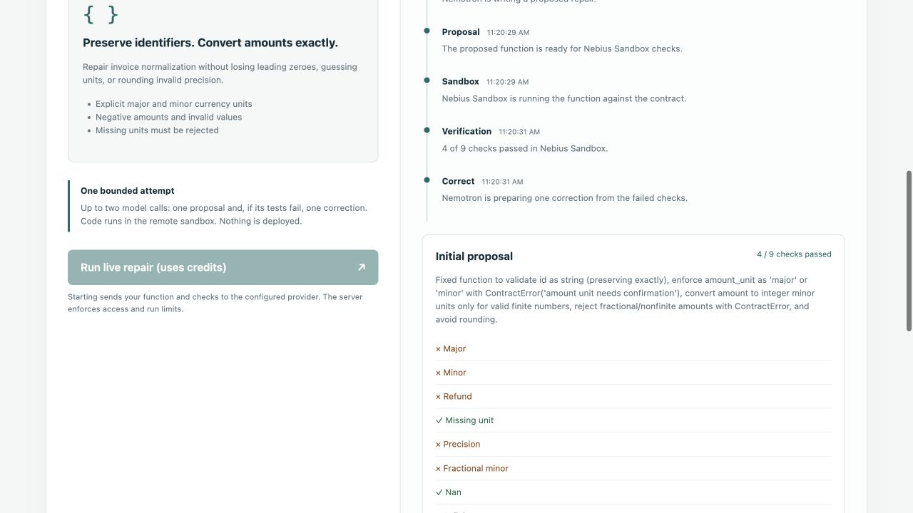

# API Repair Bench

## Judges — start here

- **Live:** [repairbench.deltaxevaluate.com/live](https://repairbench.deltaxevaluate.com/live/)
- **Replay if live allowance is used:** [saved review](https://repairbench.deltaxevaluate.com/)
- **Control boundary:** NVIDIA Nemotron proposes code; application logic binds the artifacts, runs remote validation and enforces at most one correction. The model has no deployment authority.



**Fresh functioning-app video (1:56):** [watch two October 13 browser runs](https://youtu.be/c3LWDFLwsoo): identifier repair passes 3/3 on the initial proposal; an incomplete invoice response is rejected before candidate execution. The dated September 11 correction above remains a separate historical result.

Click **Run a repair → Invoice repair → Run live repair**. Watch the trace move through NVIDIA Nemotron, Nebius Token Factory and Nebius Sandbox; inspect the generated function, named checks, stopping reason and downloadable evidence. A fresh run may pass on its first proposal or use its single correction. The exact click path is also in [JUDGES.md](JUDGES.md).

## What this is

**October 13 live verification:** two fresh recordings from the updated site show a custom identifier repair passing **3/3 checks** in Nebius Sandbox with `nvidia/Nemotron-3_5-Lightning`, with no correction required, and a nine-check invoice proposal rejected when its response reached the model length limit. No candidate was admitted or executed for the invoice run. The older invoice **4/9 → 9/9** recording above is a separate historical run. The Sandbox 403 was traced to a missing runtime project ID, which caused a placeholder project header; configuration is corrected and admission now rejects placeholders. The observation runner parses successfully, and malformed candidate code produces bound failed checks so one correction can be attempted. Strict proposal JSON is requested with model reasoning enabled. These observations are not a guarantee that every case succeeds.

**Untrusted generation. Deterministic control.** API Repair Bench is a structural control framework for AI-generated API repairs. NVIDIA Nemotron proposes code; application logic enforces the evaluation contract, remote execution path and stopping conditions. The model has no authority to deploy a patch or extend its repair loop.

Built for the Nebius × NVIDIA Global AI Hackathon, Coding and Agentic Engineering track. Original synthetic application and fixtures, developed with AI assistance under founder review. This repository does not include the private DeltaX engine.

## Reproduce locally — no account or key required

Python 3.12 is recommended. From this directory:

```sh
python3 cli.py demo
```

Open http://127.0.0.1:18767. This is a **recorded evidence replay**, not a fresh inference session. It presents the fictional reference demonstrations and separately labelled real NVIDIA/Nebius attempt results. Opening it makes no provider call and incurs no provider charge. The server exposes only bundled public assets.

Choose an integration, compare the source and reference repair, inspect the checks and recorded AI attempts, and export a reviewed reference example. Model proposals remain inert text in the browser. Keyboard controls and responsive layouts are included.

## Live workspace — public verification complete

The default public page remains the recorded review. The new `/live` workspace adds an explicit run button, progress trace, generated source, check outcomes and downloadable evidence. A visitor can select the fictional data-conversion example or supply one Python function with one to eight JSON checks. Jobs have a bounded proposal → Sandbox test → optional single correction → final result workflow. A missing or uncertain provider response is retained as unresolved, not automatically retried.

The public route has now completed a real browser-triggered run: the initial Invoice repair proposal passed 4/9 checks, the bounded correction passed 9/9, and the workflow stopped without deployment. That result is one observed run, not a reliability guarantee; historical recorded outcomes below remain separate.

The live workspace also includes a pagination case built around a real incident pattern: an HTTP 200 response dropped page 2. It checks empty pages, duplicate occurrences, repeated cursors and the request budget. See the concrete [incident card](docs/incident.md).

There are two adapters for the same product workflow:

- `live_service.py` and `custom_cases.py` provide the local Python implementation, durable SQLite jobs, visitor isolation and bounded worker execution.
- `portable-live/` provides a JavaScript core and the exact Nebius REST transport for an existing Sites Cloudflare Worker. Sites supplies the thin web/API layer; NVIDIA Nemotron inference and Python candidate execution remain on Nebius Token Factory and Nebius Sandbox. No GPU or additional application server is rented by this design.

The hosted Worker entrypoint and durable storage schema are included in deployment/. The portable-live modules remain the portable core and REST transport, so the candidate function still runs remotely in Nebius Sandbox rather than inside the website Worker. The deployment template takes NEBIUS_API_KEY and NEBIUS_PROJECT_ID from the host environment; no account-specific values are committed.

To inspect the local live UI with execution disabled:

```sh
python3 live_service.py --origin http://127.0.0.1:18768
```

Open http://127.0.0.1:18768/live. To enable your own provider-backed development run, configure `NEBIUS_API_KEY` privately and `REPAIR_BENCH_PROJECT_ID`, use the installed Sandbox dependencies, and explicitly add `--enabled`. Never put a key in source or browser code. The default limits allow three total jobs and two per visitor; the existing durable model-attempt allowance still applies. Read-only inspection must not reset job state, consumed budget or uncertain dispatches.

## Reproduce the offline checks

```sh
python3 -m unittest discover -v
node ui/test-ui.cjs
node live-ui/test-live.cjs
node --test portable-live/test-repair-core.mjs portable-live/sandbox-rest.test.mjs
node --test portable-live/test-worker.mjs deployment/test-runtime.mjs
python3 cli.py results
python3 cli.py challenge auth
```

Most Python checks use only the standard library. Two SDK-constructor checks skip until the optional Sandbox dependencies are installed; those checks forbid network access. Node is only needed for interface interaction tests. Tests do not run model-generated code locally.

`fixtures/` contains frozen model-visible challenge payloads and evaluator-only decision labels. Tests compare the current generators with those snapshots. `demo/` contains the curated recorded result export, including failed and unknown attempts. A historical result may use an earlier contract version: contract hashes distinguish it from a new experiment. Reference demonstrations are not model benchmark results.

## Run your own NVIDIA/Nebius experiment

You need your own Nebius Token Factory API key, model access and credit. Sandbox verification additionally requires active Sandbox access and your project ID. Keep your key private; the CLI requests it through a hidden terminal prompt and does not save it.

Install the reviewed SDK into a Python 3.12 virtual environment:

```sh
python3.12 -m venv .venv
.venv/bin/python -m pip install -r requirements-sandbox.txt
export REPAIR_BENCH_PROJECT_ID='your-own-project-id'
.venv/bin/python cli.py run auth --verify --allow-paid
```

The dependency is pinned to the reviewed SDK Git revision; a same-version PyPI wheel had incompatible constructor/retry behavior. Git must be available for installation. No account identifier or key is included in this repository.

`--allow-paid` explicitly opts into a provider action. A new model attempt reserves $0.01 against this installation's fixed $0.25 application allowance before dispatch. The reservation is a conservative local control, **not a billed price, provider-enforced cap, or account-wide spending limit**. The model request and Sandbox usage can have provider charges. Price estimates are a recorded September 2026 configuration and may change; check your provider account before running.

Local receipts and the durable ledger are stored under ignored `output/`. Never delete or replace them to retry uncertain effects or regain the allowance. This public installation's ledger is separate from the original experiment, which is not distributed here. No API request automatically retries.

To generate without Sandbox execution:

```sh
.venv/bin/python cli.py run pagination --allow-paid
```

To verify a previously generated, untested valid proposal, copy the returned run ID:

```sh
.venv/bin/python cli.py verify YOUR_RUN_ID --allow-paid
```

One correction can be requested after a completed failed baseline on the same contract:

```sh
.venv/bin/python cli.py correct YOUR_RUN_ID --allow-paid
```

That command only requests the correction; verification is a separate explicit command. Missing-unit and explicit-unit decision controls can be generated with `run decision-missing_unit` or `run decision-explicit_major_unit`; their decision quality is assessed by `ambiguity_cases.score_decision`, and their patches are not executed by the current CLI. `--verify` skips these decision controls.

## Architecture: proposal authority without deployment authority

API Repair Bench treats generated source as untrusted input to a bounded protocol. NVIDIA Nemotron supplies a proposal. Application code controls admission, validation, remote dispatch, comparison, correction eligibility and termination. The model cannot grant itself another attempt or a deployment capability through its response.

The hosted path has three distinct responsibilities:

1. **Control plane:** validates requests and proposals, reserves attempts in durable storage, enforces stage transitions and retains outcomes.
2. **Execution plane:** Nebius Sandbox runs the candidate and observation runner remotely. The dispatch requests no inherited environment, disabled networking, a 20-second runtime limit and a 64 KiB limit per output stream.
3. **Comparison plane:** application code compares returned observations with an external plan, verifies their binding and records named outcomes.

The remote boundary separates generated execution from the website Worker and development machine. The comparison boundary keeps the final decision logic outside the candidate runtime. These are meaningful controls, but neither establishes an independently trusted observation process: the candidate and observation runner currently share a Python process inside Sandbox.

### Artifact binding

Canonical challenge and proposal records receive SHA-256 digests. The execution bundle carries a run identifier, challenge digest and proposal digest; each uploaded file also receives a content digest. The adapter snapshots the bundle before asynchronous uploads, recomputes file digests, and checks provider-reported upload digests and byte counts. Comparison rejects outputs with mismatched run, challenge or proposal identifiers.

These checks detect artifact substitutions or mismatches at the checked boundaries. They are not signatures, remote attestation or proof that the candidate emitted truthful observations. Receipts retain `trusted_execution_proven: false` even when the declared checks match.

### Finite correction and effect control

A completed, bound initial failure may receive one correction on the same contract. A passing attempt stops for review. A failed correction also stops. Invalid or incomplete proposals do not gain execution authority; uncertain effectful stages are not automatically redispatched.

Durable phase tokens and stage leases constrain progression, and reservations gate admission. These controls bound this application's workflow. They do not create a provider-enforced or account-wide spending cap. Deterministic control logic does not make probabilistic model output deterministic or prove arbitrary Python safe.

### Observable failure is an architectural property

The evidence model distinguishes proposal rejection, failed contract checks, infrastructure faults, incomplete provider responses, uncertain effects and changed contracts. A changed interface starts a different evaluation. A successful correction retains its baseline so recovered checks and regressions can be examined.

The September 11 invoice recording shows one same-contract 4/9 → 9/9 correction. The fresh October 13 video shows a separate 3/3 identifier proposal and an incomplete invoice proposal rejected before candidate execution. It does not claim a fresh correction. These are observed synthetic runs, not general reliability measurements or proof of production readiness.

### Next engineering gate

Establish an observation boundary that candidate code cannot control: separate runner and candidate processes; restrict validation telemetry and filesystem access; keep comparison material and control credentials outside candidate reach; authenticate observation provenance independently of candidate-generated stdout; and exercise these boundaries with adversarial tests.

Repository-wide operation additionally requires explicit limits on file access, permitted changes, test execution and approval. Broader scope should follow verified boundaries, rather than confer broader authority on the model by default. Export remains distinct from merge or deployment.

## Recorded outcomes

See the replay and `demo/evidence.json` for the frozen aggregate, and `demo/recorded-data.js` for curated per-attempt checks and contracts.

| Experiment | Baseline | Correction | Observed outcome |
|---|---:|---:|---|
| Authentication, original contract | 4/6 | 4/6 | No recovery |
| Authentication, clarified response interface | 6/6 | Not attempted | Separate successful baseline; contract changed |
| Data conversion, initial feedback | 4/9 | 4/9 | No recovery |
| Data conversion, runtime exception diagnostics | 4/9 | 9/9 | Same-contract correction recovered five checks; zero check regressions |

The final data-conversion result is one successful paired correction among three evaluated pairs. Both amount-unit decision controls matched their expected decisions; those are decision checks, not patch-runtime checks. Pagination did not yield a valid patch. All 16 model attempts remain represented: 14 returned responses and two uncertain timeouts. These small synthetic results do not establish general repair reliability.

## License and attribution

Original application code and synthetic assets: MIT, see LICENSE. Dependencies and NVIDIA model/API access retain their own licenses and service terms; see THIRD-PARTY.md. Model weights and third-party SDK implementations are not distributed here.
